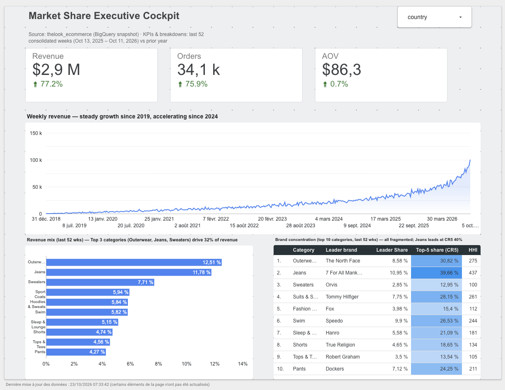

# Market Share Executive Cockpit

**Market share analysis and executive dashboard on an e-commerce dataset — BigQuery + Looker Studio.**



---

## Business questions

1. How is the business growing, and what drives the growth — more customers or bigger baskets?
2. Where does revenue come from (revenue mix by category)?
3. Within each category, is the brand market dominated by a few leaders or fragmented?

## Key findings (last 52 consolidated weeks, Oct 13, 2025 – Oct 11, 2026)

| | Value | YoY |
|---|---|---|
| Revenue | $2.9M | **+77.2%** |
| Orders | 34.1k | **+75.9%** |
| AOV | $86.3 | +0.7% |

- **Growth is volume-driven.** Revenue growth comes almost entirely from more orders; average order value is flat. The next growth lever is basket size (cross-selling, bundles).
- **Revenue is diversified.** The top 3 categories (Outerwear, Jeans, Sweaters) account for only **32%** of revenue; the next seven categories each weigh 4–6%.
- **Brand markets are fragmented.** Every top-10 category has an **HHI below 500** (unconcentrated; US 2023 Merger Guidelines threshold for "highly concentrated" is 1,800). Jeans is the most concentrated (CR5 ≈ 40%, leader 7 For All Mankind ≈ 11%); Sweaters is the least (CR5 ≈ 13%).
  - *Concentrated categories* → negotiate partnerships with the few leading brands.
  - *Fragmented categories* → compete on assortment and price; candidates for a private label.

## Architecture

```
bigquery-public-data.thelook_ecommerce
        │  one-off snapshot (frozen source)
        ▼
raw_orders · raw_order_items · raw_products · raw_users      (tables)
        ▼
stg_orders                       remove cancelled / returned orders
        ▼
int_order_line_enriched          order line + category, brand, country
        ▼
┌───────────────────────────┬────────────────────────────┬──────────────────────────────┐
mart_weekly_country_kpi       mart_weekly_kpi               mart_category_concentration
week × country                week × category × country     category (last 52 weeks)
KPIs, AOV, revenue trend      revenue mix                   leader share, CR5, HHI
└───────────────────────────┴────────────────────────────┴──────────────────────────────┘
        ▼
Looker Studio — Market Share Executive Cockpit
```

| File | Layer | Grain |
|---|---|---|
| `sql/01_raw_snapshot.sql` | raw | source tables, frozen |
| `sql/02_stg_orders.sql` | staging | order |
| `sql/03_int_order_line_enriched.sql` | intermediate | order line |
| `sql/04_mart_weekly_kpi.sql` | mart | ISO week × category × country |
| `sql/05_mart_weekly_country_kpi.sql` | mart | ISO week × country |
| `sql/06_mart_category_concentration.sql` | mart | category |
| `sql/analysis/` | ad-hoc | diagnostic queries behind the decisions below |

Run the files in numeric order in the BigQuery console.

## Data quality decisions

These are the issues found while building the dashboard, and how each was resolved.

**1. Grain mismatch → orders overcounted by 41%.**
The first mart was at *week × category × country*. An order containing items from two categories was counted once per category, so the company-level order count was 125,789 instead of 89,105, and AOV showed $61.6 instead of $86.9 (−30%).
*Fix:* a dedicated mart at *week × country* for order counts; AOV computed as `SUM(revenue) / SUM(orders)` (never an average of averages). Validated with a revenue reconciliation between the two marts (exact match). → `sql/analysis/a2_grain_reconciliation.sql`

**2. Immature recent data.**
The trend showed a sudden +73% week-on-week jump. A day-level diagnosis showed orders stable at ~170–200/day, then growing 30–60% per day over the last ~7 days: the source generator keeps back-filling recent days.
*Fix:* marts keep only ISO weeks that ended more than 7 days before the snapshot date. → `sql/analysis/a1_data_maturity_check.sql`

**3. Non-reproducible source.**
The public dataset is regenerated daily: historical totals changed from one day to the next.
*Fix:* a raw snapshot layer; the consolidation cutoff is anchored on the snapshot's latest date, not on `CURRENT_DATE()`.

**4. Week label vs. date.**
A text week label (`%Y-W%W`) split the year-crossing week into two rows and could not drive a time axis.
*Fix:* a real `DATE` column (`DATE_TRUNC(..., ISOWEEK)`), with the label derived from it (`%G-W%V`, ISO year + ISO week).

**5. Small-sample categories.**
Tiny categories (e.g. Clothing Sets, ~$4k/year) looked "concentrated" only because a handful of orders decide the ranking.
*Fix:* concentration is shown for the top 10 categories by revenue only (`revenue_rank`).

## Metrics

| Metric | Definition |
|---|---|
| AOV | Revenue ÷ distinct orders |
| Revenue mix | Category revenue ÷ total revenue |
| Brand share | Brand revenue in a category ÷ category revenue |
| CR5 | Sum of the 5 largest brand shares in a category |
| HHI | Σ (brand share)² × 10,000 — all brands, weights large players more |

## Dashboard design

- Executive layout read top-left to bottom-right: KPIs with YoY → long-term trend → composition.
- One accent colour; every chart title states the conclusion, not just the content (the dashboard is published as a static screenshot, without tooltips).
- One consistent period (last 52 consolidated weeks) for KPIs and breakdowns; only the trend chart shows full history.
- The country filter applies to KPIs, trend and revenue mix; the concentration table is explicitly labelled *global*, because shares must not be re-aggregated across countries.

## Limitations

- `thelook_ecommerce` is a **synthetic** dataset: growth rates and the recent acceleration reflect how the data is generated, not real market dynamics. The project demonstrates the method.
- "Market share" here is the share of each brand **within this retailer's sales**, not of the external market.
- The dashboard period uses fixed dates matching the snapshot; refreshing the snapshot requires updating them.
- Built in the BigQuery sandbox (tables expire after 60 days): the dashboard is presented as a screenshot; the SQL in this repo rebuilds everything from the public source.

## Stack

Google BigQuery (GoogleSQL: CTEs, window functions) · Looker Studio · layered modelling (raw → staging → intermediate → mart)
